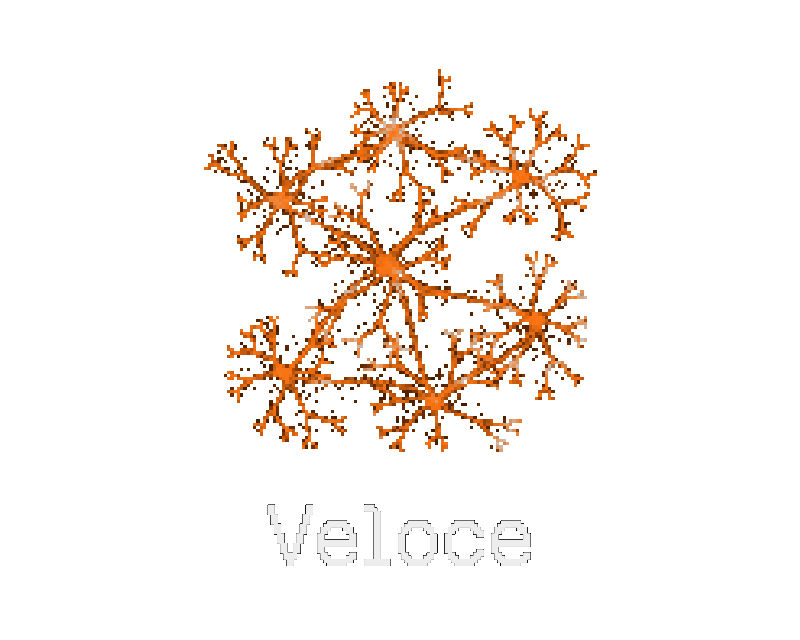

  

  <strong>A software engineering harness for craftsmen and software artisans.</strong> 
  Build software for humans and AI, by humans and AI.

  

  <a href="#overview">Overview</a> ·
  <a href="#architecture">Architecture</a> ·
  <a href="#how-it-works">How it works</a> ·
  <a href="LICENSE">License</a>

## Overview

Veloce is a software engineering harness designed to help people and agents build reliable software with the mindset of a craftsperson. It aims to make disciplined engineering practices part of the development loop rather than an afterthought.

The project brings together clear instructions, repeatable workflows, and practical guardrails so that planning, implementation, review, and verification remain consistent as software evolves.

Veloce is intentionally tool- and model-agnostic. The goal is not to prescribe a single way to write software, but to provide a dependable foundation that teams can adapt to their own stack and standards.

## Architecture

## How it works

### Project initialization

Use the [init skill instructions](.github/skills/init/SKILL.md) to initialize project
documentation. They create or update
`docs/DECISIONS.md`, `docs/ARCHITECTURE.md`, root `PROGRESS.md` and
`docs/FEATURES.md` with the project's decisions, architecture, current state and
verifiable feature list. Existing documentation and history are preserved;
unknowns and unavailable verification commands are recorded explicitly.
It also creates a root `AGENTS.md` with project-specific agent instructions
when that file does not already exist, leaving existing instructions unchanged.

The skill lives in `.github/skills/init`. Project skill discovery and `/init`
availability depend on the agent tool's support and configuration.

### Agent instructions

Agent instructions are kept identical across the formats used by the supported
tools:

- `AGENTS.md` for OpenCode and other AGENTS.md-compatible agents
- `.github/copilot-instructions.md` for GitHub Copilot

Keep both files aligned manually. Inspect both files and reconcile independent
changes before updating shared instructions.

### Initialization scripts

Run `./init` to create an empty `.github/AGENT.md` at the project root.
It also creates root `PROGRESS.md` and `DECISIONS.md` with their respective templates.
It creates `.github/` if needed and preserves existing files' contents.

This script does not register a slash command with an agent tool; the `/init`
skill is documented above.

## License

Veloce is available under the [MIT License](LICENSE), with the exception of the
Caveman-derived response-style guidance. Its attribution and license notices are
in [.github/skills/caveman/NOTICE](.github/skills/caveman/NOTICE).

  <em>In memory of the software craftsmen who laid the foundations for today's technology and agentic revolution.</em>

